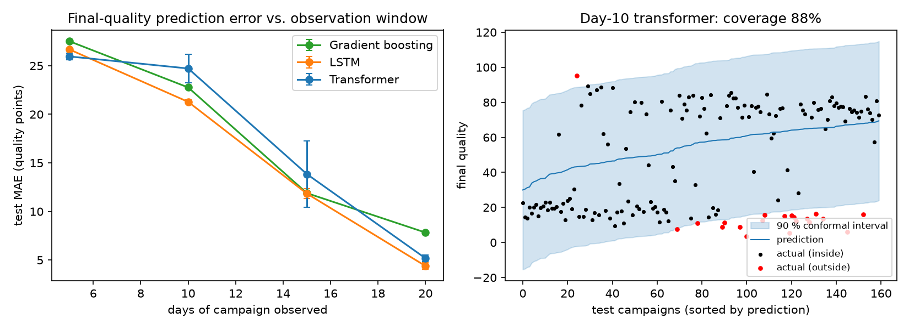

# P2 — Early prediction of final product quality, with calibrated uncertainty

**Question.** After seeing only the first *k* days of a 30-day continuous
fermentation, how well can we predict the final product quality? Can we put an
honest error bar on that prediction?

> Synthetic data. There are 800 simulated chemostat campaigns from
> [`fermsim/simulator.py`](fermsim/simulator.py), with 6 hourly sensors, a slowly
> spreading colonial C-variant, temperature excursions and plant drift. This was
> built in November 2026, with AI assistance, as preparation for a PhD application.

## Setup

- **Input:** sensor history up to day *k* (biomass, dissolved O₂, temperature, CO₂ off-gas, pH, dilution rate), resampled to 2-hourly. *k* ∈ {5, 10, 15, 20}.
- **Target:** final quality score (0–100), which falls mainly when the C-variant takes over. The distribution is **bimodal**: about 43% of campaigns are taken over and end near 15, the rest end near 80.
- **Chronological split:** train on the earliest 60% of campaigns, calibrate on the next 20%, and test on the latest 20%. Models are always scored on "future" campaigns, including the effect of plant drift.
- **Models:**
  - gradient boosting on hand-crafted summary statistics
  - a 2-layer LSTM
  - a transformer encoder over 12-hour patches with a CLS token
  - The neural models use 3 seeds each.
- **Uncertainty:** split conformal prediction on the calibration block, giving 90% intervals with a finite-sample coverage guarantee under exchangeability.
- **Reference points** ([`oracle.py`](oracle.py)):
  - *trivial*: always predict the training-set mean
  - *oracle*: gradient boosting on the **true hidden C-variant fraction**, which no real sensor gives you

## Results

Test MAE in quality points, lower is better. Neural models are mean ± std over 3 seeds.

| Day *k* | Trivial | Gradient boosting | LSTM | Transformer | *Oracle (hidden state)* |
|---|---|---|---|---|---|
| 5 | 29.0 | 27.5 | 26.7 ± 0.0 | **26.0 ± 0.3** | *6.5* |
| 10 | 29.0 | 22.8 | **21.3 ± 0.2** | 24.7 ± 1.5 | *6.0* |
| 15 | 29.0 | 11.9 | **11.8 ± 0.5** | 13.9 ± 3.4 | *5.3* |
| 20 | 29.0 | 7.8 | **4.4 ± 0.4** | 5.2 ± 0.4 | *5.0* |

90% conformal intervals on the test set (seed-ensemble predictions):

| Day *k* | GB coverage / ±width | LSTM coverage / ±width | Transformer coverage / ±width |
|---|---|---|---|
| 5 | 0.89 / ±53.5 | 0.87 / ±44.7 | 0.87 / ±46.9 |
| 10 | 0.84 / ±44.9 | 0.89 / ±49.1 | 0.88 / ±45.4 |
| 15 | 0.91 / ±31.3 | 0.90 / ±34.0 | 0.93 / ±40.5 |
| 20 | 0.91 / ±23.0 | 0.91 / ±10.0 | 0.88 / ±9.3 |



## What the results show

1. **The outcome is decided early but isn't yet observable.** At day 5 the oracle predicts final quality to within about 6.5 points, so in the simulator, whether a takeover happens is largely settled. The sensor models are barely better than the trivial predictor, because a C-variant at about 0.1% of the population leaves no trace in biomass, O₂ or CO₂. The early-prediction bottleneck is **measurement, not model capacity**. That's the motivation for adding morphology and proteomics in P3.
2. **The transformer doesn't win.** With 400 training campaigns, the LSTM is as good or better from day 10 onwards, and the transformer has larger seed-to-seed variance. Gradient boosting on summary statistics is competitive up to day 15. Attention models need more data, or pre-training, to pay off. This is why it matters to include strong simple baselines.
3. **By day 20, sequence models are close to the oracle.** At an MAE of 4.4, the variant has spread enough to show in the sensors, and the LSTM extracts it better than summary features do (7.8).
4. **The conformal intervals are valid but not adaptive.** Coverage is close to the nominal 90% at every horizon, including on later campaigns affected by drift. But split conformal gives one width for every campaign. With a bimodal target, a day-10 interval of ±45 covers nearly the whole 0–100 range, so it's honest but not useful for decisions. The better options are **conformalised quantile regression** (adaptive widths), or a **two-stage model**: predict the takeover probability, then quality conditional on each outcome, giving a bimodal predictive distribution.

## Limitations and next steps

- One simulator, one kind of drift. Exchangeability is only approximately true under drift, so for a real plant, weighted or adaptive conformal methods would be safer.
- 400 training campaigns is small for transformers. Pre-training on unlabelled sensor history, through masked reconstruction, is the natural next step.
- No hyperparameter search was done. All models use reasonable defaults with early stopping on a validation block taken from the training period.

## Run

Python 3.12, CPU only.

```bash
pip install -r requirements.txt
python scripts/generate_data.py                  # once; creates data/campaigns.npz
python train.py      # about 1–3 h on a CPU
python oracle.py     # a few minutes
```

## Part of a four-project series

These four projects share one simulated fermentation process: a chemostat with a colonial C-variant, plant drift, and sensor, micrograph and proteomics data. Each project's results motivate the next, and together they point towards hybrid mechanistic–ML models. References to P1–P4 in this README mean:

| | Project |
|---|---|
| P1 | [Physics-informed neural network for fermentation kinetics](https://github.com/arqam3025/pinn-fermentation-kinetics) |
| P2 | [Early quality prediction with conformal intervals](https://github.com/arqam3025/fermentation-quality-forecasting) (this repository) |
| P3 | [Multimodal cross-attention for C-variant detection](https://github.com/arqam3025/multimodal-cvariant-detection) |
| P4 | [Morphology CNN with Grad-CAM](https://github.com/arqam3025/hyphal-morphology-cnn-gradcam) |
